# VAJRA: Technical Architecture & System Design Document
**Predictive Maintenance & Fleet Availability Platform**  
**Smart India Hackathon 2026** | **Problem Statement PS 26249** | **Ministry of Defence**  
**Author / Platform Team:** VAJRA Engineering Directorate  
**Review Status:** Prepared for External Technical Code Review  

---

## 1. Executive Summary & Problem Context

Military aviation operational readiness requires high aircraft availability. In traditional operating environments, aircraft maintenance is fragmented and largely reactive:
- Data from aircraft health-monitoring sensors, technical logs, base spares inventories, and maintenance bay schedules are silod.
- Faults are discovered late, causing avoidable downtime, grounding critical assets, and straining logistics.

**VAJRA** solves this through an integrated, air-gapped, offline platform combining:
1. **Multi-Source Data Ingestion**: Unified ingestion of health telemetry, technical logs, spares, and maintenance depot capacity into an integrated relational database.
2. **AI/ML Fleet Prognostics**: Remaining Useful Life (RUL) regression (XGBoost vs Random Forest baseline), Isolation Forest anomaly scoring, and SHAP explainability.
3. **Deterministic Safety Envelope**: Rule engine evaluating sensor thresholds with pre-breach early warning alerts and automated lead-time calculation.
4. **Maintenance Optimization**: Automated bay scheduling, risk-ranked work orders, and inter-base spares allocation.
5. **14-Day Fleet Availability Forecasting**: Simulation under Baseline, Predictive, and Reactive operational scenarios.
6. **3D Digital Twin Engine**: Interactive WebGL CAD rendering of the airframe (33 parts) and turbofan assembly (7 modules) with X-ray, exploded separation, and real-time telemetry animation.

---

## 2. High-Level System Architecture Diagram

```mermaid
flowchart TD
    subgraph DataSources["Integrated Data Sources (Read-Only)"]
        CSV1["Telemetry & Health Records\n(engine_health_status.csv)"]
        CSV2["Technical & Maintenance Records\n(maintenance_history.csv)"]
        CSV3["Spares Logistics\n(spares_inventory.csv)"]
        CSV4["Bases & Maintenance Agencies\n(bases_maintenance_agencies.csv)"]
    end

    subgraph CoreBackend["FastAPI Offline Application Core (Port 8000)"]
        Ingest["Data Loader & Normalizer\n(backend/scripts/load_data.py)"]
        DB[(SQLite Relational Core\nvajra.db)]
        RuleEng["Deterministic Rule Engine\n(backend/app/core/rule_engine.py)"]
        MLCore["ML Prognostics & SHAP\n(ml/inference.py + ml/live_scoring.py)"]
        Sim["Real-Time Telemetry Simulator\n(backend/app/services/simulator.py)"]
        Opt["Maintenance Optimizer\n(backend/app/api/routes/maintenance.py)"]
        Audit["Tamper-Evident Audit Logger\n(backend/app/services/audit.py)"]
        Auth["JWT & RBAC Security Layer\n(backend/app/core/security.py)"]
    end

    subgraph FrontendUI["Tactical Frontend Layer (Tailwind + WebGL)"]
        Bridge["VAJRA Bridge Controller\n(vajra-bridge.js)"]
        Twin3D["3D Digital Twin Canvas\n(Three.js + OrbitControls)"]
        Dash["Command Dashboard"]
        Engines["Fleet Engine Explorer"]
        Planner["Maintenance Scheduler"]
        Spares["Spares Inventory Matrix"]
        Avail["Fleet Availability 14-Day"]
        Reports["PDF/CSV Analytics & Reports"]
    end

    CSV1 --> Ingest
    CSV2 --> Ingest
    CSV3 --> Ingest
    CSV4 --> Ingest
    Ingest --> DB

    DB <--> MLCore
    DB <--> RuleEng
    DB <--> Opt
    DB <--> Sim
    DB <--> Audit

    CoreBackend <-->|REST API + WebSocket /ws/live| Bridge
    Bridge --> Dash
    Bridge --> Engines
    Bridge --> Planner
    Bridge --> Spares
    Bridge --> Avail
    Bridge --> Reports
    Bridge --> Twin3D
```



---

## 3. Subsystem Breakdown

### 3.1 Data Ingestion & Relational Architecture (`backend/app/models/`)
All four core sources (health monitoring, maintenance records, spares, and maintenance agencies) are normalized and persisted in a single transactional SQLite database (`vajra.db`) via SQLModel (SQLAlchemy 2.0):
- **Bases & Agencies** (`BaseAgency`): 5 military bases (`Base 01` to `Base 05`), tracking hangar slot capacities and assigned aircraft.
- **Fleet Aircraft** (`Aircraft`): 24 aircraft across 4 generic military airframe types (`Fighter-B`, `Transport-A`, `Trainer-C`, `Heli-D`).
- **Engines** (`Engine` & `EngineHealthStatus`): 42 propulsion engines with exact fleet invariant health partitioning:
  - **Healthy (70–100%)**: 27 engines
  - **Watch (40–69%)**: 12 engines
  - **Critical (0–39%)**: 3 engines (`ENG-003`, `ENG-007`, `ENG-019`)
- **Component Health** (`ComponentHealth`): Subsystem wear attribution across Fan, Compressor, Combustor, Turbine, and Shaft.
- **Rule Engine Thresholds** (`RuleEngineThreshold`): Safety limits for EGT, vibration, oil pressure, N1, and N2.
- **Spares Inventory** (`SparesInventory`): 10 critical parts across all 5 bases with min levels and lead times.
- **Maintenance Tasks & Work Orders** (`MaintenanceTask`): Risk-ranked task pipeline with approval tracking.
- **Audit Log** (`AuditLog`): Non-repudiable log recording all critical actions with user attribution.

### 3.2 AI/ML Predictive Prognostics Pipeline (`ml/`)
- **Target**: Remaining Useful Life (`RUL`, capped at 125 flight cycles to mitigate linear decay skew).
- **Primary Model**: Tuned **XGBoost Regressor** (`max_depth=3`, `learning_rate=0.08`, `n_estimators=120`).
- **Baseline Model**: **Random Forest Regressor** (`max_depth=12`, `n_estimators=100`).
- **Evaluation Methodology**:
  - **Training Split**: 60 engines across all life cycles.
  - **Cross-Validation**: 5-Fold `GroupKFold` grouped strictly by `engine_id` to eliminate temporal data leakage.
  - **Holdout Test Set**: 20 unseen engines evaluated on their terminal end-of-life cycle.
  - **Metrics**: XGBoost achieves CV RMSE of 9.77 cycles and NASA Asymmetric Score of 134.95.
- **Explainability**: Local SHAP feature attribution calculates percentage contributions of each sensor channel (e.g., T48 exit temperature, bearing vibration).

### 3.3 Early Detection & Safety Cascade (`backend/app/core/rule_engine.py`)
1. **Fault Injection**: Controlled fault ramp (e.g., `vibration_spike`, `oil_pressure_drop`) smooths sensor deviation over several ticks.
2. **Monotonic Anomaly Rise**: Anomaly score rises steadily as health degrades.
3. **ML Early Warning**: When an engine enters the Watch band ($40 \le \text{health} \le 69$), an ML alert (`source="ml"`, severity Medium) is broadcast *before* physical rule limit breaches.
4. **Lead Time Calculation**: Measures the elapsed time (seconds/ticks) between the initial ML warning and subsequent safety threshold breaches.
5. **Fail-Safe Fallback**: If ML is disabled (`ML_ENABLED=false`), the deterministic rule engine independently raises High/Critical alerts when safety thresholds break.

### 3.4 3D Digital Twin Engine (`frontend/4._3d_digital_twin_expansive_view/`)
- **Airframe Model** (`vajra_aircraft_twin.glb`): 33 discrete structural, mechanical, and avionics meshes.
- **Turbofan Model** (`vajra_engine.glb`): 7 internal modules (`Fan`, `Compressor`, `Combustion_Chamber`, `Turbine`, `Shaft`, `Casing`, `Nozzle`).
- **Shader Palettes**:
  - **Hybrid**: Subsystem color with health status emissive glow.
  - **Health**: Red (`#EF4444`) for Critical, Amber (`#D9A21B`) for Watch, Green (`#3FA34D`) for Nominal.
  - **System**: Functional engineering system color coding.
- **Interactive Capabilities**:
  - 100% default exploded view separation along module-specific axes.
  - Translucent outer shell (14% opacity) in X-ray mode.
  - Reversible engineering tests: engine spool rotation (120 RPM) and $\pm 12^\circ$ control surface deflection.
  - Synchronized telemetry scrubber replay aligned to `13:58 IST`.

---

## 4. File Structure & Directory Tree

```
VAJRA_REVIEW/
├── ARCHITECTURE.md                  # Comprehensive system design document (this file)
├── README.md                        # Quickstart instructions, execution commands, and review guide
├── Makefile                         # Unified automation targets (setup, train, load-data, serve, test)
├── requirements.txt                 # Pinned Python package dependencies
├── .env.example                     # Sanitized configuration template
│
├── frontend/                        # Tactical Web UI (Offline Single Page Applications)
│   ├── Assets/                      # Local GLB models, preview renders, and vendored libraries
│   │   ├── Models/                  # vajra_aircraft_twin.glb, vajra_engine.glb, Blender source files
│   │   └── vendor/                  # Local Three.js, OrbitControls, GLTFLoader, Tailwind, fonts
│   ├── vajra-bridge.js              # Central frontend controller, API client, WebGL hydration
│   ├── vajra-3d-models.js           # Supplementary 3D geometry definitions
│   ├── 4._3d_digital_twin_expansive_view/  # 3D Digital Twin Expansive CAD Screen
│   ├── command_dashboard/           # Executive Command & Readiness Dashboard
│   ├── engines_list/                # Fleet Engine Inventory with filter & search
│   ├── 3._engine_detail_eng_003/    # Deep-dive engine diagnostic & SHAP view
│   ├── 6._maintenance_planner_refined_alignment/ # Hangar slot & task optimization
│   ├── 7._spares_logistics/         # Base inventory matrix & transfer modal
│   ├── 8._fleet_availability/       # 14-day mission demand vs readiness projection
│   ├── 8._reports/                  # PDF & CSV analytics reporting center
│   ├── 10._data_simulator/          # Fault injection & live WebSocket simulator
│   ├── settings/                    # Thresholds, health bands, bases & users
│   ├── audit_log/                   # Tamper-evident immutable action log
│   └── terminal_authentication_vajra/ # Military terminal login screen
│
├── backend/                         # FastAPI Application Core
│   ├── app/
│   │   ├── main.py                  # Application entry point, CORS, routers & static mounts
│   │   ├── config.py                # Environment configuration loader
│   │   ├── database.py              # SQLite engine & session management
│   │   ├── api/routes/              # 15 modular REST API routers
│   │   │   ├── alerts.py            # Alert lifecycle (Ack, Assign, Resolve, Work Order)
│   │   │   ├── audit.py             # Audit log queries
│   │   │   ├── auth.py              # JWT authentication & session verification
│   │   │   ├── dashboard.py         # KPI aggregations & readiness calculation
│   │   │   ├── data.py              # CSV file uploads & row validation
│   │   │   ├── engines.py           # Engine listings & component wear breakdown
│   │   │   ├── fleet.py             # 14-day availability scenario projections
│   │   │   ├── health.py            # Quick health check endpoints
│   │   │   ├── maintenance.py       # Task planner, hangar slot solver, approval
│   │   │   ├── reports.py           # On-demand PDF/CSV report generation
│   │   │   ├── settings.py          # Dynamic thresholds, bands, user management
│   │   │   ├── simulator.py         # Fault injection & invariant reset API
│   │   │   ├── spares.py            # Inter-base transfer dispatch & forecast
│   │   │   ├── system.py            # Node health, database metrics, model status
│   │   │   └── websocket.py         # High-throughput live telemetry stream
│   │   ├── core/                    # Core business logic
│   │   │   ├── auth.py              # RBAC role guards (Fleet Commander, Maintenance Officer, Analyst)
│   │   │   ├── rule_engine.py       # Deterministic safety envelope & threshold evaluator
│   │   │   └── security.py          # Password hashing (bcrypt) & JWT issuance
│   │   ├── models/                  # SQLModel schema declarations
│   │   ├── schemas/                 # Pydantic request/response transfer models
│   │   └── services/                # Specialized domain services
│   │       ├── audit.py             # Transactional audit entry writer
│   │       ├── pdf_report.py        # ReportLab PDF vector graphics compiler
│   │       └── simulator.py         # Background telemetry loop & fault injector
│   ├── scripts/
│   │   └── load_data.py             # Ingestion script populating vajra.db from CSVs
│   ├── seed/
│   │   └── demo_overrides.json      # Deterministic seed overrides
│   ├── API_ENDPOINTS.md             # Complete REST API specification
│   └── openapi.json                 # OpenAPI 3.0 specification
│
├── database/                        # Database Architecture Reference
│   ├── models/                      # Copy of SQLModel database schemas
│   └── seed/                        # Ingestion scripts & demo overrides
│
├── data/                            # Canonical Raw Ingestion Datasets (Read-Only)
│   ├── alerts.csv                   # Historical alert logs
│   ├── bases_maintenance_agencies.csv # 5 base locations, hangar bays & capacities
│   ├── component_health.csv         # Subsystem component telemetry
│   ├── engine_health_status.csv     # 42 engine baseline scores & RUL
│   ├── engines.csv                  # Physical engine serials and types
│   ├── fleet_aircraft.csv           # 24 airframe records & base assignments
│   ├── fleet_availability_history.csv # 90-day operational readiness records
│   ├── maintenance_history.csv      # Depot maintenance history
│   ├── mission_demand_next14d.csv   # Operational demand per base
│   ├── rule_engine_thresholds.csv   # Engineering safety thresholds
│   ├── spares_inventory.csv         # Base parts stock counts
│   └── train_sensor_run_to_failure.csv # Run-to-failure degradation sensor data
│
├── ml/                              # Machine Learning Prognostics Pipeline
│   ├── train.py                     # Training script with GroupKFold cross-validation
│   ├── inference.py                 # RUL prediction, anomaly scoring & SHAP computation
│   ├── live_scoring.py              # Real-time sensor stream scoring
│   ├── preprocessing.py             # Sensor normalization & rolling feature extraction
│   ├── metrics.json                 # Model comparison metrics (XGBoost vs RandomForest)
│   ├── sensor_component_map.json    # Mapping sensors to physical engine parts
│   └── models/                      # Serialized Joblib model binaries
│
├── tests/                           # Pytest Automated Test Suite (34 Tests)
│   ├── conftest.py                  # Temporary DB fixture (protects production DB)
│   ├── test_api_endpoints.py        # REST endpoint status, payload & RBAC tests
│   ├── test_database.py             # Invariant checks (42/27/12/3 counts)
│   ├── test_ml.py                   # Model inference, SHAP, and GroupKFold tests
│   ├── test_rule_engine.py          # Safety rule evaluation & fallback mode tests
│   └── test_websocket.py            # Live WebSocket stream & fault ramp tests
│
├── scripts/                         # Standalone Acceptance & Audit Executables
│   ├── acceptance_test.py           # End-to-end acceptance runner (6 verification steps)
│   └── test_3d_twin_screen.py       # Exhaustive 3D Twin audit script (53 controls)
│
└── QA/                              # QA Reports & Historical Artifacts
    ├── QA_REPORT.md                 # Complete system audit report across all screens
    ├── twin_test_report.md          # 3D Digital Twin verification report
    ├── inventory.md                 # Initial workspace inventory
    ├── CHANGELOG.md                 # Change log of architectural fixes
    └── DEMO_SCRIPT.md               # Step-by-step evaluator walkthrough
```

---

## 5. Fleet Invariants & Health Bands

| Metric | Target Value | Implementation Guard |
|---|:---:|---|
| **Total Engines** | **42** | Enforced at load time (`load_data.py`) and verified by `test_database.py` |
| **Healthy Engines** | **27** (Health 70–100%) | Verified in DB and on all dashboard KPI cards |
| **Watch Engines** | **12** (Health 40–69%) | Verified in DB and on all dashboard KPI cards |
| **Critical Engines** | **3** (Health 0–39%) | `ENG-003`, `ENG-007`, `ENG-019` |
| **Total Aircraft** | **24** | Distributed across 5 bases |
| **Operational Bases** | **5** | Generic designations: `Base 01` through `Base 05` |
| **Healthy Band** | **70 – 100%** | Green status (`#3FA34D`), nominal flight readiness |
| **Watch Band** | **40 – 69%** | Amber status (`#D9A21B`), early inspection warning |
| **Critical Band** | **0 – 39%** | Red status (`#EF4444`), immediate ground hold |

---

## 6. Security, RBAC & Secret Handling

1. **Role-Based Access Control (RBAC)**:
   - **Fleet Commander** (`IAF-001`): Full administrative access (approve maintenance, transfer spares, override thresholds, user administration).
   - **Maintenance Officer** (`IAF-002`): Operational access (create work orders, assign tasks, request parts, acknowledge alerts).
   - **Analyst** (`IAF-003`): Read-only analytical access (view dashboards, inspect SHAP values, generate reports).
2. **Cryptographic Integrity**:
   - Passwords hashed using standard `bcrypt` with salt.
   - JWT session tokens signed using `HS256`.
3. **No External Secrets**:
   - All models, dependencies, fonts, and assets operate strictly offline.
   - Default seed passwords in `.env.example` allow testing in local environments while isolating production secrets.
