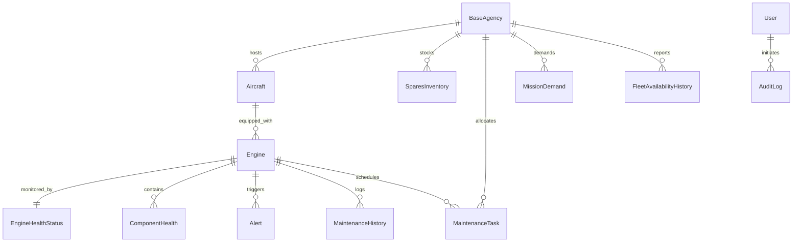

# VAJRA Relational Database Schema & Invariants Specification
**Database Engine:** SQLite 3 (`vajra.db`)  
**ORM / Framework:** SQLModel (SQLAlchemy 2.0 Core)  

---

## 1. Relational Entity Overview

The VAJRA database integrates four disparate data streams into 11 relational tables:

---

## 2. Table Specifications

### 2.1 `base_agencies`
- **Primary Key:** `base_id` (`VARCHAR(10)`)
- **Fields:** `base_name` (e.g. `Base 01`), `location` (generic coordinates), `hangar_bays` (Integer), `max_concurrent_aircraft` (Integer).
- **Invariant:** Exactly 5 bases (`Base 01` to `Base 05`).

### 2.2 `aircraft`
- **Primary Key:** `aircraft_id` (`VARCHAR(20)`)
- **Foreign Key:** `base_id` $\rightarrow$ `base_agencies.base_id`
- **Fields:** `aircraft_type` (`Transport-A`, `Fighter-B`, `Trainer-C`, `Heli-D`), `status` (`Active`, `Maintenance`, `Awaiting Spares`).
- **Invariant:** Exactly 24 aircraft.

### 2.3 `engines`
- **Primary Key:** `engine_id` (`VARCHAR(20)`, e.g., `ENG-001` through `ENG-042`)
- **Foreign Key:** `aircraft_id` $\rightarrow$ `aircraft.aircraft_id`
- **Fields:** `model` (`Turbofan-TF1`), `installed_date`, `total_flight_hours`, `cycles_since_overhaul`.
- **Invariant:** Exactly 42 engines.

### 2.4 `engine_health_status`
- **Primary Key:** `id` (Integer autoincrement)
- **Foreign Key:** `engine_id` $\rightarrow$ `engines.engine_id`
- **Fields:** `health_score` (Float 0–100), `status` (`Healthy`, `Watch`, `Critical`), `predicted_rul_cycles` (Integer), `anomaly_score` (Float 0–1), `failure_risk_7d` (Float 0–1), `last_updated` (Timestamp).
- **Core Fleet Invariant:**
  - `Healthy` (70–100): Exactly 27 engines
  - `Watch` (40–69): Exactly 12 engines
  - `Critical` (0–39): Exactly 3 engines (`ENG-003`, `ENG-007`, `ENG-019`)

### 2.5 `component_health`
- **Primary Key:** `id` (Integer autoincrement)
- **Foreign Key:** `engine_id` $\rightarrow$ `engines.engine_id`
- **Fields:** `component` (`Fan`, `Compressor`, `Combustion Chamber`, `Turbine`, `Shaft`), `health_score` (Float), `colour` (`Green`, `Yellow`, `Red`), `shap_contribution` (Float), `spare_part_id` (`PRT-001` to `PRT-010`).

### 2.6 `spares_inventory`
- **Primary Key:** `id` (Integer autoincrement)
- **Foreign Key:** `base_id` $\rightarrow$ `base_agencies.base_id`
- **Fields:** `part_id` (`PRT-001` through `PRT-010`), `part_name`, `quantity_in_stock`, `minimum_safe_stock`, `unit_cost_inr`, `lead_time_days`.
- **Matrix Dimension:** 10 parts $\times$ 5 bases = 50 discrete inventory tracking cells.

### 2.7 `maintenance_tasks`
- **Primary Key:** `task_id` (`VARCHAR(30)`)
- **Fields:** `engine_id`, `aircraft_id`, `base_id`, `component`, `part_id`, `maintenance_type`, `urgency` (`Immediate`, `Within 7 Days`, `Within 14 Days`), `status` (`Suggested`, `Scheduled`, `Approved`, `In Progress`, `Completed`), `scheduled_date`, `estimated_downtime_hours`.

### 2.8 `alerts`
- **Primary Key:** `alert_id` (`VARCHAR(50)`)
- **Fields:** `timestamp`, `engine_id`, `aircraft_id`, `severity` (`Low`, `Medium`, `High`, `Critical`), `trigger`, `anomaly_score`, `rul_cycles`, `status` (`Unacknowledged`, `Acknowledged`, `In Progress`, `Resolved`), `source` (`ml`, `rule_engine`), `lead_time_seconds` (Float).

### 2.9 `rule_engine_thresholds`
- **Primary Key:** `id` (Integer autoincrement)
- **Fields:** `parameter` (e.g. `egt_c`, `vibration_mm_s`, `oil_pressure_psi`), `operator` (`>`, `<`), `threshold` (Float), `severity`, `recommended_action`.

### 2.10 `users`
- **Primary Key:** `service_id` (`VARCHAR(20)`)
- **Fields:** `name`, `role` (`Fleet Commander`, `Maintenance Officer`, `Analyst`), `password_hash` (`bcrypt`), `base_id`, `is_active` (Boolean), `created_at`.

### 2.11 `audit_log`
- **Primary Key:** `id` (Integer autoincrement)
- **Fields:** `timestamp`, `user_id`, `action`, `resource_type`, `resource_id`, `details`, `ip_address`.
